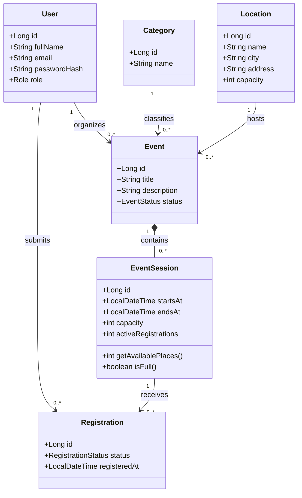
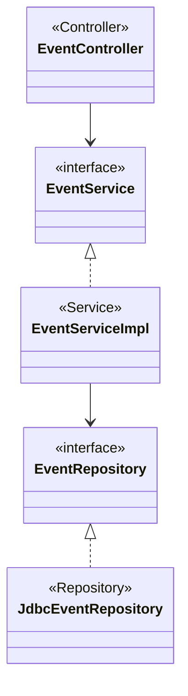

# Final Project: EventHub

## 1. Your assignment

Build a server-rendered web application for managing events and registering participants. An organizer creates an event and schedules its sessions. A participant finds a published event and registers for a session. Persist application data in PostgreSQL and render pages with Spring MVC and Thymeleaf.

You will design and write the Java domain model, JDBC repositories, service and repository interfaces and implementations, MVC controllers, access checks, error handling, and tests. The PostgreSQL schema and demonstration data are provided. The starter project contains no unfinished Java methods for you to fill in.

### Technology requirements

- Java 25, Maven, Spring Boot, Spring Core, Spring MVC, Thymeleaf, and Bean Validation.
- PostgreSQL and JDBC with `DataSource`, `Connection`, `PreparedStatement`, and `ResultSet`.
- Spring transactions for operations requiring consistent changes.
- JUnit and Mockito for your own tests.
- REST APIs, Spring Data JPA, Hibernate, and Spring Security are outside the scope of this project.

## 2. Starter project and your responsibilities

The starter repository provides:

| Provided | Purpose |
| --- | --- |
| `pom.xml`, Maven Wrapper, `EventHubApplication`, `application.properties`, `.gitignore` | Java version, dependencies, application entry point, and environment-based database settings. |
| Thymeleaf templates and CSS | Page layout, form URLs, field names, and expected view model attributes. |
| `database/create-database.sql`, `database/schema.sql`, `database/data.sql` | Create the local database and account, the provided tables, and date-independent demonstration data. |
| `src/test` | Open integration and architecture tests that define the verified application behavior. |
| This specification and a starter README | Requirements and setup instructions. |

**You must create:** all domain classes, form DTOs and enums; every service and repository interface described below; implementations of these interfaces and their JDBC queries for the provided database; MVC controllers; a session authentication filter; a session user model; application exceptions and a global exception handler; meaningful tests; and the required documentation.

Keep the supplied HTML templates, SQL scripts, open tests, URLs, and field names intact. Implement the specified interfaces yourself with the exact packages and method signatures. You may add helper classes and methods where they help. The diagrams are requirements for your implementation, not supplied implementation code.

## 3. Domain model and UML

### 3.1. Domain relationships



An event may initially have no sessions; it must have at least one session **before publication**. `Role` values are `ORGANIZER` and `PARTICIPANT`. `EventStatus` values are `DRAFT`, `PUBLISHED`, `CANCELLED`, and `COMPLETED`. `RegistrationStatus` values are `ACTIVE` and `CANCELLED`. Support `COMPLETED` in the model and storage; automatic transition to this status is not required.

Domain objects must expose the values used by the supplied templates. In addition to the fields shown in the diagram, `Event` exposes its category, location, organizer ID and organizer name; `EventSession` exposes its event ID and available places; `Registration` exposes its session ID, participant ID, participant name/email, event title, and session start time. Use foreign keys for database relationships. You decide how to map JDBC results into Java objects.

### 3.2. Required layers



Apply the same dependency pattern to the other services and repositories. Controllers accept requests, validate forms, call service interfaces, and select a view or redirect. Service implementations enforce business rules and transaction boundaries. JDBC repositories execute SQL and map rows. A controller must not access a repository or JDBC directly; a service must not contain SQL; a repository must not decide whether a user is allowed to perform a business action. Do not add interfaces to DTOs, entities, or controllers merely to match a naming pattern.

## 4. Required Java contracts

Create the following interfaces yourself in `com.epam.eventhub.service` and `com.epam.eventhub.repository`. Put service implementations in `com.epam.eventhub.service.impl` and JDBC implementations in `com.epam.eventhub.repository.jdbc`. Related types belong in `com.epam.eventhub.model`, `com.epam.eventhub.dto`, and `com.epam.eventhub.session`. Imports have been omitted from the listings.

### 4.1. Services

```java
public interface AuthService {
    AuthenticatedUser authenticate(String email, String password);
    AuthenticatedUser register(RegistrationForm form);
}

public interface CatalogService {
    List<Category> getCategories();
    List<Location> getLocations();
    List<String> getCities();
}

public interface EventService {
    List<Event> findPublished(EventSearchCriteria criteria);
    Event getById(long eventId);
    List<EventSession> getSessions(long eventId);
    EventSession requireSessionOwner(long sessionId, long organizerId);
    List<Event> findForOrganizer(long organizerId);
    Event create(EventForm form, long organizerId);
    void update(long eventId, EventForm form, long organizerId);
    EventSession addSession(long eventId, SessionForm form, long organizerId);
    void publish(long eventId, long organizerId);
    void cancel(long eventId, long organizerId);
    Event requireOwner(long eventId, long organizerId);
}

public interface RegistrationService {
    long register(long sessionId, long participantId); // returns the event ID
    void cancel(long registrationId, long participantId);
    List<Registration> findForParticipant(long participantId);
    List<Registration> findActiveForSession(long sessionId);
}

```

Also create a `PasswordEncoder` technical interface with `String encode(String rawPassword)` and `boolean matches(String rawPassword, String encodedPassword)`. Implement it with PBKDF2 and a random salt. Lists returned by service methods must not give callers access to mutable internal state.

### 4.2. Repositories

```java
public interface UserRepository {
    Optional<User> findById(long id);
    Optional<User> findByEmail(String email);
    boolean existsByEmail(String email);
    User save(User user);
}

public interface CategoryRepository {
    List<Category> findAll();
}

public interface LocationRepository {
    List<Location> findAll();
    List<String> findCities();
}

public interface EventRepository {
    Optional<Event> findById(long id);
    List<Event> findPublished(EventSearchCriteria criteria);
    List<Event> findByOrganizerId(long organizerId);
    Event save(EventForm form, long organizerId);
    void update(long eventId, EventForm form);
    void updateStatus(long eventId, EventStatus status);
}

public interface EventSessionRepository {
    Optional<EventSession> findById(long id);
    List<EventSession> findByEventId(long eventId);
    EventSession save(long eventId, SessionForm form);
}

public interface RegistrationRepository {
    Optional<Registration> findById(long id);
    Optional<Registration> findBySessionAndParticipant(long sessionId, long participantId);
    int countActiveBySessionId(long sessionId);
    Registration create(long sessionId, long participantId);
    void reactivate(long registrationId);
    void cancel(long registrationId);
    void cancelActiveByEventId(long eventId);
    List<Registration> findByParticipantId(long participantId);
    List<Registration> findActiveBySessionId(long sessionId);
}
```

`findPublished` searches the event title or description and optionally filters by category and city. `findCities` returns available cities without duplicates. `save` and `create` return entities with database-generated IDs.

### 4.3. Forms and authenticated user

Create DTOs with the following fields, which match the supplied templates:

| DTO | Fields |
| --- | --- |
| `LoginForm` | `email`, `password` |
| `RegistrationForm` | `fullName`, `email`, `password`, `role` |
| `EventForm` | `title`, `description`, `categoryId`, `locationId` |
| `SessionForm` | `startsAt`, `endsAt`, `capacity` |
| `EventSearchCriteria` | `query`, `categoryId`, `city` |

Session start and end values use `LocalDateTime`; both must be in the future, and the end must follow the start. Validate forms with Bean Validation and service-level business checks. Store only an `AuthenticatedUser` containing `id`, `fullName`, `email`, and `role` in the HTTP session under the attribute name `currentUser`. Do not store a password or password hash in that object.

## 5. Required behavior

### Participant

1. Register, sign in with email and password, and sign out.
2. Browse published events; search title/description and filter by category/city.
3. Open an event and see sessions and available places.
4. Register for a future session of a published event.
5. View and cancel personal registrations before a session begins. Register again after cancellation if a place is still available.

### Organizer

1. Register, sign in, and see only personally organized events.
2. Create an event as `DRAFT` and edit a personally owned draft.
3. Add one or more future sessions to a personally owned draft.
4. Publish a draft with at least one session or cancel an eligible event.
5. View active participants of a personally owned session.

### Business rules

1. Only the owning organizer may manage an event and access its participants.
2. Only `DRAFT` events can be edited, given new sessions, or published.
3. Session capacity is positive and cannot exceed its location capacity; its end must follow its start.
4. Only users with the `PARTICIPANT` role can register, and only for future sessions of published events.
5. A participant cannot have two active registrations for the same session.
6. Active registration count must never exceed session capacity.
7. Only the owner may cancel a registration, and only before the session starts. Repeating a cancellation must not corrupt data.
8. Cancelling an event also cancels its active registrations. A completed event cannot be cancelled. Repeating cancellation of a cancelled event must not corrupt data.
9. Invalid form values, missing records, and denied access must be handled with distinct, understandable outcomes.

Check access in the service layer even if a link is hidden in HTML or a filter protects the URL.

## 6. MVC pages and routes

Implement `AuthController`, `EventController`, `OrganizerController`, and `RegistrationController`, plus global error handling. The supplied templates expect these routes and model attributes:

| HTTP method and path | Purpose, view, and model attributes |
| --- | --- |
| GET `/`, GET `/events` | Catalog: `events/list`; `events`, `categories`, `cities`, `criteria`. |
| GET `/events/{eventId}` | Details: `events/details`; `event`, `sessions`, `currentUser`. |
| GET/POST `/login` | `auth/login`; `loginForm`; `loginError` for failed login. |
| GET/POST `/register` | `auth/register`; `registrationForm`, `roles`; `registrationError` for a business error. |
| POST `/logout` | Invalidate the session and redirect to the catalog. |
| GET `/organizer/events` | `organizer/events`; `events`. |
| GET/POST `/organizer/events/create` | `organizer/event-form`; `eventForm`, `categories`, `locations`, `pageTitle`, `formAction`. |
| GET/POST `/organizer/events/{eventId}/edit` | The same form for an owned draft. |
| GET/POST `/organizer/events/{eventId}/sessions/add` | `organizer/session-form`; `event`, `sessions`, `sessionForm`. |
| POST `/organizer/events/{eventId}/publish` | Publish a draft. |
| POST `/organizer/events/{eventId}/cancel` | Cancel the event and its active registrations. |
| GET `/organizer/sessions/{sessionId}/participants` | `organizer/participants`; `sessionId`, `registrations`. |
| POST `/sessions/{sessionId}/register` | Register the current participant. |
| GET `/profile/registrations` | `profile/registrations`; `registrations`. |
| POST `/registrations/{registrationId}/cancel` | Cancel the current participant's registration. |

The templates form a contract for URLs, fields, and model attribute names. Display form validation and business errors on the relevant pages. Use POST for state changes and a redirect after successful form submission. Make `currentUser` available to the shared navigation template.

## 7. PostgreSQL and JDBC

The starter project provides `database/schema.sql` and `database/data.sql`. The schema contains six tables: `users`, `categories`, `locations`, `events`, `event_sessions`, and `registrations`. Dates in the demonstration data are calculated relative to installation time, so the supplied sessions remain usable whenever the project is deployed. Run the scripts as described in the README, study the tables, and implement the Java code that works with them. Do not modify the supplied SQL scripts.

The provided PostgreSQL schema contains constraints that your Java code must respect:

- Primary and foreign keys matching the UML relationships.
- A unique user email; store email in normalized form.
- A unique `(session_id, participant_id)` pair, with reactivation of a cancelled row.
- Positive capacities and `ends_at > starts_at`.
- Required values and valid roles and statuses.

Use parameterized `PreparedStatement` queries and release JDBC resources properly. Integrate connections with Spring-managed transactions. Retrieve generated IDs. Do not concatenate user input into SQL. At the repository boundary, wrap checked `SQLException` in `DataAccessException` and preserve its cause.

Register a participant and cancel an event in transactions. Registration checks the remaining capacity and then creates or reactivates a registration. Event status and its active registrations must be changed as one operation when an event is cancelled.

## 8. Authentication, errors, and logging

- Store passwords only as salted PBKDF2 hashes. Compare them through `PasswordEncoder.matches`; two encodings of the same password must differ.
- Protect private routes for unauthenticated users with a filter and enforce ownership and applicable role checks again in the service layer. Hiding buttons is insufficient.
- Provide `AuthenticationException`, `AccessDeniedException`, `EntityNotFoundException`, `BusinessRuleException`, `DataAccessException`, and `PasswordEncodingException`. A shared base class is optional.
- Handle failed login, missing data, denied access, business rule violations, and technical failures distinctly. Do not catch every `RuntimeException` solely to display its message.
- Use `@ControllerAdvice` to return 404 for missing records, 403 for denied access, useful feedback for invalid input, and a safe 500 page for technical failures. Do not expose SQL, stack traces, passwords, or connection details in the browser.
- Log significant successful operations and technical failures, using IDs and an error reference where appropriate. Never log plaintext passwords or password hashes.

## 9. Open tests, your own tests, and architecture explanation

The starter contains an open JUnit test suite for the scenarios below. These tests start the Spring Boot context, create an H2 in-memory database in PostgreSQL compatibility mode, and load test data equivalent to the supplied `data.sql`. Dates are calculated relative to the test run, so the checks do not depend on a fixed calendar date. Do not modify or remove the supplied tests; implement the application until they pass.

In addition, write your own service-layer unit tests with JUnit and Mockito. Cover at least one successful and one failing scenario for each of `AuthService`, `EventService`, and `RegistrationService`. Inject a `Clock` and use fixed time in your own tests for rules that depend on the current time.

| No. | Required scenario |
| ---: | --- |
| 1 | The same password produces two different salted PBKDF2 hashes; the correct password matches and an incorrect password does not. |
| 2 | Registration normalizes email; duplicate email is rejected; correct and incorrect passwords produce different login results. |
| 3 | The catalog returns only published events; search and filters exclude non-matching events. |
| 4 | The owner edits an owned draft; a different organizer and a published status prevent editing. |
| 5 | A draft without sessions cannot be published; a draft with a valid session can be published. |
| 6 | A valid future session is created; an invalid period and nonpositive or excessive capacity are rejected. |
| 7 | The first registration creates one active row; a duplicate active registration creates no duplicate. |
| 8 | Registration is rejected after all session places are occupied. |
| 9 | A participant cancels an owned future registration; another participant and a started session prevent cancellation. |
| 10 | Registration after cancellation reactivates the existing row instead of creating another one. |
| 11 | Cancelling an event cancels its active registrations; a different organizer cannot perform the operation. |
| 12 | Missing data, denied access, a business-rule violation, and a technical failure are handled differently. |

Create `docs/architecture-decisions.md` and briefly answer these questions **using your own code as evidence**:

1. Where do the Controller, Service, and Repository boundaries lie, and why use the required interfaces?
2. How are validation, business rules, and SQL responsibilities divided between layers?
3. Which changes belong to one transaction during registration and event cancellation, and why?
4. Where is `SQLException` translated, and how does a business error differ from a technical error?
5. Why store a separate `AuthenticatedUser` in the HTTP session?
6. Which rules are enforced in Java and also by PostgreSQL constraints?

Write one or two substantive paragraphs per question and mention relevant classes/methods. A general essay about Spring is not needed.

## 10. Submission and completion

Submit one Git repository with the application source, required contracts and implementations, unchanged supplied templates, SQL scripts, and open tests, `pom.xml`, your own unit tests, `docs/architecture-decisions.md`, and a `README.md`. The README must explain how to deploy the supplied database, set `DB_URL`, `DB_USERNAME`, and `DB_PASSWORD`, run `./mvnw test` and `./mvnw spring-boot:run`, open the application, and demonstrate both user roles. Never commit real deployment credentials; the supplied credentials are for the local learning database only.

The project is complete when it builds with Java 25, all supplied and student-written tests pass, the supplied scripts initialize PostgreSQL, Spring Boot starts, and all organizer and participant scenarios work in a browser with the demonstration data.
