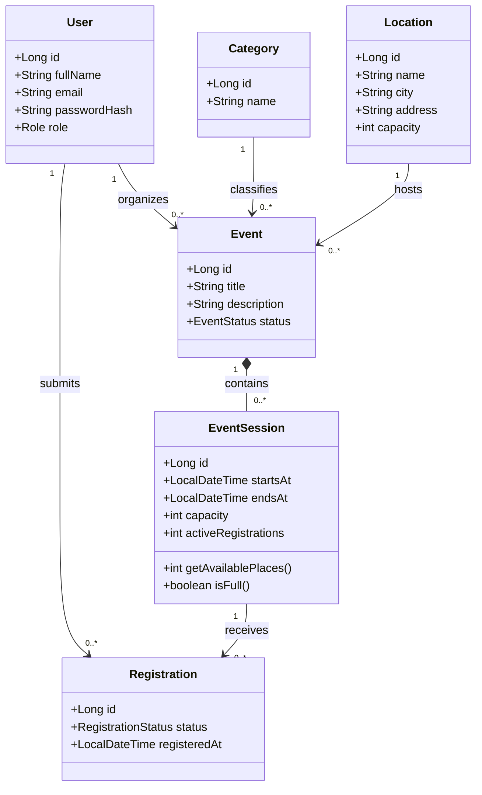
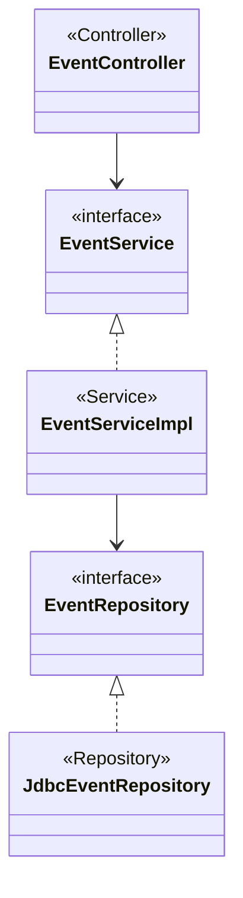

# Итоговый проект Java Fundamentals: EventHub

## 1. Назначение и рамки проекта

Создайте на Java 25 серверное веб-приложение для организации мероприятий и регистрации участников. Организатор создаёт мероприятие и назначает сеансы, участник находит опубликованное мероприятие и записывается на выбранный сеанс. Данные хранятся в PostgreSQL. Страницы отображаются средствами Spring MVC и Thymeleaf.

В этом проекте вы самостоятельно проектируете и реализуете модель Java, JDBC-репозитории, сервисы, контроллеры, проверку доступа, обработку ошибок и тесты. Схема PostgreSQL и демонстрационные данные предоставлены. Задание описывает требуемое поведение и обязательные контракты; готовые методы с пометками TODO не выдаются.

### Технологические рамки

- Java 25, Maven, Spring Boot, Spring Core, Spring MVC, Thymeleaf, Bean Validation.
- PostgreSQL и JDBC: `DataSource`, `Connection`, `PreparedStatement`, `ResultSet`.
- Spring `@Transactional` для операций, затрагивающих несколько изменений.
- JUnit и Mockito для собственных тестов.
- REST API, Spring Data JPA, Hibernate и Spring Security в эту работу не входят.

## 2. Исходные материалы и объём работы

В стартовом репозитории вы получаете:

| Предоставляется | Что это задаёт |
| --- | --- |
| `pom.xml`, Maven Wrapper, `EventHubApplication`, `application.properties`, `.gitignore` | Версии, запуск, подключение через `DB_URL`, `DB_USERNAME`, `DB_PASSWORD`. |
| Готовые Thymeleaf-шаблоны и CSS | Внешний вид, адреса форм, имена полей и модель представления. |
| `database/create-database.sql`, `database/schema.sql`, `database/data.sql` | Создание локальной базы, готовых таблиц и демонстрационных данных. |
| `src/test` | Открытые интеграционные и архитектурные тесты, фиксирующие проверяемое поведение приложения. |
| Это ТЗ и стартовый README | Полные требования и инструкция по настройке и запуску. |

**Студент создаёт с нуля:** доменные классы, DTO форм и перечисления, все указанные интерфейсы и их реализации, JDBC-запросы для выданной базы, MVC-контроллеры, фильтр доступа, модель пользователя для HTTP-сессии, классы исключений, `@ControllerAdvice` и содержательные тесты.

Готовые HTML-шаблоны, SQL-скрипты, открытые тесты, адреса страниц и имена полей форм менять не следует. Контракты ниже необходимо создать в указанных пакетах и с указанными сигнатурами. Дополнительные вспомогательные классы и методы допустимы, если сохраняются обязательные зависимости и внешнее поведение. Диаграммы описывают требуемое решение, а не являются готовым кодом.

## 3. Функциональные требования

### 3.1. Участник

1. Создаёт аккаунт, входит по email и паролю и выходит из приложения.
2. Просматривает каталог опубликованных мероприятий, выполняет поиск по названию или описанию, фильтрует по категории и городу.
3. Открывает страницу мероприятия и видит его сеансы и количество свободных мест.
4. Регистрируется на будущий сеанс опубликованного мероприятия.
5. Просматривает свои регистрации, отменяет свою регистрацию до начала сеанса и может повторно зарегистрироваться после отмены, если осталось место.

### 3.2. Организатор

1. Создаёт аккаунт, входит и просматривает только собственные мероприятия.
2. Создаёт мероприятие в статусе `DRAFT` и редактирует собственный черновик.
3. Добавляет к собственному черновику будущие сеансы.
4. Публикует черновик, содержащий хотя бы один сеанс, или отменяет допустимое мероприятие.
5. Просматривает активных участников сеанса собственного мероприятия.

### 3.3. Бизнес-правила

1. Управлять мероприятием и просматривать его участников может только организатор-владелец.
2. Редактировать мероприятие, добавлять сеансы и публиковать его можно только в статусе `DRAFT`.
3. Начало и окончание сеанса находятся в будущем; окончание позже начала.
4. Вместимость сеанса положительна и не превышает вместимость выбранной локации.
5. Только пользователь с ролью `PARTICIPANT` может регистрироваться на будущий сеанс опубликованного мероприятия.
6. У участника не может быть двух активных регистраций на один сеанс; число активных регистраций не превышает вместимость.
7. Отменить регистрацию может только её владелец и только до начала сеанса. Повторная отмена не должна повреждать данные.
8. При повторной регистрации после отмены существующая запись активируется повторно; новая строка для той же пары участник–сеанс не создаётся.
9. Отмена мероприятия одновременно отменяет его активные регистрации. Завершённое мероприятие отменить нельзя; повторная отмена уже отменённого мероприятия не повреждает данные.
10. Пустые и некорректные значения отклоняются с понятным результатом. Отсутствующая запись, отказ в доступе, нарушение бизнес-правила и технический сбой обрабатываются различными способами.

Роль и владение проверяются в сервисном слое, даже если ссылка скрыта в HTML или маршрут закрыт фильтром.

## 4. Предметная область и UML

### 4.1. Сущности и связи



Событие сначала может существовать без сеансов; **публикация** требует хотя бы один сеанс. `User.role` принимает `ORGANIZER` или `PARTICIPANT`. `EventStatus`: `DRAFT`, `PUBLISHED`, `CANCELLED`, `COMPLETED`. `RegistrationStatus`: `ACTIVE`, `CANCELLED`. Статус `COMPLETED` должен поддерживаться моделью и хранением, но автоматического перевода событий в этот статус заданием не требуется.

Доменные объекты должны предоставлять данные, необходимые шаблонам: `Event` содержит категорию, локацию, ID и имя организатора; `EventSession` — ID события, число активных регистраций и вычисляемые доступные места; `Registration` — ID сеанса/участника, имя и email участника, название события и время начала сеанса. Для связей в БД используйте внешние ключи; способ построения объектов из результатов JDBC выбираете самостоятельно.

## 5. Архитектура и обязательные контракты

### 5.1. Разделение слоёв



Такая же схема применяется к другим сервисам и репозиториям. Контроллер принимает запрос, валидирует форму, вызывает сервис и выбирает страницу/редирект. Сервис обеспечивает правила предметной области и транзакции. Репозиторий выполняет SQL и преобразует строки БД в объекты. Контроллеру нельзя вызывать репозиторий напрямую; сервису нельзя выполнять SQL; репозиторию нельзя решать, разрешено ли пользователю совершать действие. DTO, контроллеры и сущности не обязаны иметь отдельные интерфейсы.

### 5.2. Программные контракты

Сигнатуры ниже являются обязательным контрактом для реализации. Студент создаёт сами интерфейсы и классы, реализующие их. Пакеты: `com.epam.eventhub.service` и `com.epam.eventhub.repository`. Реализации размещаются в `service.impl` и `repository.jdbc`. Контракты работают с `com.epam.eventhub.model`, `com.epam.eventhub.dto` и `com.epam.eventhub.session`. Импорты в примерах опущены для краткости.

#### 5.2.1. Сервисы

```java
public interface AuthService {
    AuthenticatedUser authenticate(String email, String password);
    AuthenticatedUser register(RegistrationForm form);
}

public interface CatalogService {
    List<Category> getCategories();
    List<Location> getLocations();
    List<String> getCities();
}

public interface EventService {
    List<Event> findPublished(EventSearchCriteria criteria);
    Event getById(long eventId);
    List<EventSession> getSessions(long eventId);
    EventSession requireSessionOwner(long sessionId, long organizerId);
    List<Event> findForOrganizer(long organizerId);
    Event create(EventForm form, long organizerId);
    void update(long eventId, EventForm form, long organizerId);
    EventSession addSession(long eventId, SessionForm form, long organizerId);
    void publish(long eventId, long organizerId);
    void cancel(long eventId, long organizerId);
    Event requireOwner(long eventId, long organizerId);
}

public interface RegistrationService {
    long register(long sessionId, long participantId); // возвращает ID события
    void cancel(long registrationId, long participantId);
    List<Registration> findForParticipant(long participantId);
    List<Registration> findActiveForSession(long sessionId);
}

```

`PasswordEncoder` — отдельный технический контракт с методами `String encode(String rawPassword)` и `boolean matches(String rawPassword, String encodedPassword)`. Студент пишет реализацию с PBKDF2 и случайной солью. Значения возвращаемых коллекций должны быть безопасны для вызывающего кода: изменение полученного списка не должно менять внутреннее состояние сервиса.

#### 5.2.2. Репозитории

```java
public interface UserRepository {
    Optional<User> findById(long id);
    Optional<User> findByEmail(String email);
    boolean existsByEmail(String email);
    User save(User user);
}

public interface CategoryRepository {
    List<Category> findAll();
}

public interface LocationRepository {
    List<Location> findAll();
    List<String> findCities();
}

public interface EventRepository {
    Optional<Event> findById(long id);
    List<Event> findPublished(EventSearchCriteria criteria);
    List<Event> findByOrganizerId(long organizerId);
    Event save(EventForm form, long organizerId);
    void update(long eventId, EventForm form);
    void updateStatus(long eventId, EventStatus status);
}

public interface EventSessionRepository {
    Optional<EventSession> findById(long id);
    List<EventSession> findByEventId(long eventId);
    EventSession save(long eventId, SessionForm form);
}

public interface RegistrationRepository {
    Optional<Registration> findById(long id);
    Optional<Registration> findBySessionAndParticipant(long sessionId, long participantId);
    int countActiveBySessionId(long sessionId);
    Registration create(long sessionId, long participantId);
    void reactivate(long registrationId);
    void cancel(long registrationId);
    void cancelActiveByEventId(long eventId);
    List<Registration> findByParticipantId(long participantId);
    List<Registration> findActiveBySessionId(long sessionId);
}
```

`findPublished` ищет по названию или описанию и при необходимости фильтрует по категории и городу. `findCities` возвращает города без дубликатов. Методы `save` и `create` возвращают объекты с ID, сгенерированными базой.

#### 5.2.3. Формы и данные HTTP-сессии

Создайте DTO со следующими полями, которые ожидают готовые шаблоны:

| DTO | Поля |
| --- | --- |
| `LoginForm` | `email`, `password` |
| `RegistrationForm` | `fullName`, `email`, `password`, `role` |
| `EventForm` | `title`, `description`, `categoryId`, `locationId` |
| `SessionForm` | `startsAt`, `endsAt`, `capacity` |
| `EventSearchCriteria` | `query`, `categoryId`, `city` |

Даты сеанса задаются как `LocalDateTime`; обе должны быть в будущем, конец позже начала. Поля форм проверяйте средствами Bean Validation и бизнес-проверками. Объект `AuthenticatedUser` для HTTP-сессии должен содержать только `id`, `fullName`, `email`, `role`; атрибут сессии называется `currentUser`. Пароль и его хеш туда помещать нельзя.

## 6. MVC-страницы и маршруты

Разработайте контроллеры `AuthController`, `EventController`, `OrganizerController`, `RegistrationController` и общий обработчик ошибок. Готовые шаблоны должны открываться и получать указанные атрибуты модели:

| Метод и путь | Назначение / шаблон / данные |
| --- | --- |
| GET `/`, GET `/events` | Каталог: `events/list`; `events`, `categories`, `cities`, `criteria`. |
| GET `/events/{eventId}` | Детали: `events/details`; `event`, `sessions`, `currentUser`. |
| GET/POST `/login` | `auth/login`; `loginForm`, при ошибке `loginError`. |
| GET/POST `/register` | `auth/register`; `registrationForm`, `roles`, при ошибке `registrationError`. |
| POST `/logout` | Завершить сессию и перенаправить в каталог. |
| GET `/organizer/events` | `organizer/events`; `events`. |
| GET/POST `/organizer/events/create` | `organizer/event-form`; `eventForm`, `categories`, `locations`, `pageTitle`, `formAction`. |
| GET/POST `/organizer/events/{eventId}/edit` | Та же форма для своего черновика. |
| GET/POST `/organizer/events/{eventId}/sessions/add` | `organizer/session-form`; `event`, `sessions`, `sessionForm`. |
| POST `/organizer/events/{eventId}/publish` | Опубликовать черновик. |
| POST `/organizer/events/{eventId}/cancel` | Отменить мероприятие и его активные регистрации. |
| GET `/organizer/sessions/{sessionId}/participants` | `organizer/participants`; `sessionId`, `registrations`. |
| POST `/sessions/{sessionId}/register` | Записать текущего участника на сеанс. |
| GET `/profile/registrations` | `profile/registrations`; `registrations`. |
| POST `/registrations/{registrationId}/cancel` | Отменить собственную регистрацию. |

Готовые шаблоны являются контрактом по URL, названиям полей и атрибутам модели. На страницах должны отображаться понятные ошибки валидации и бизнес-правил. Изменение данных выполняется POST-запросами; после успешной операции используйте редирект, чтобы обновление страницы не повторяло отправку формы. `currentUser` должен быть доступен общему шаблону навигации.

## 7. PostgreSQL и JDBC

В стартовом проекте выданы `database/schema.sql` и `database/data.sql`. Схема содержит шесть таблиц: `users`, `categories`, `locations`, `events`, `event_sessions`, `registrations`. Демонстрационные даты в `data.sql` вычисляются относительно момента развёртывания, поэтому данные остаются пригодными для запуска в любое время. Разверните скрипты по README, изучите таблицы и реализуйте Java-код для работы с ними. Изменять выданные SQL-скрипты не требуется.

Java-код должен учитывать ограничения предоставленной схемы:

- первичные и внешние ключи для связей UML;
- уникальный email пользователя; рекомендуем хранить нормализованный email;
- уникальная пара `(session_id, participant_id)` с повторной активацией ранее отменённой записи;
- положительная вместимость локации и сеанса, `ends_at > starts_at`;
- допустимые значения ролей/статусов и обязательные поля.

SQL-запросы выполняйте параметризованным `PreparedStatement`. Корректно закрывайте `ResultSet` и `PreparedStatement` через try-with-resources; соединения освобождайте так, чтобы JDBC участвовал в Spring-транзакциях. Извлекайте сгенерированные ID. Не используйте конкатенацию введённого пользователем текста в SQL. `SQLException` преобразуйте на границе репозитория в `DataAccessException` с сохранением причины.

Регистрацию участника и отмену мероприятия выполняйте в транзакциях. При регистрации проверьте доступность места и создайте либо повторно активируйте запись. При отмене мероприятия изменение его статуса и отмена активных регистраций должны завершиться как единая операция.

## 8. Безопасность, исключения и логирование

- Храните пароль только как солёный PBKDF2-хеш. Сравнивайте пароль через `PasswordEncoder.matches`; одинаковые исходные пароли должны давать разные хеши.
- Закрывайте служебные URL фильтром для неавторизованных пользователей и повторно проверяйте право доступа в сервисе. Нельзя полагаться на скрытые кнопки как на защиту.
- Создайте прикладные исключения: `AuthenticationException`, `AccessDeniedException`, `EntityNotFoundException`, `BusinessRuleException`, `DataAccessException`, `PasswordEncodingException` (допускается общий базовый класс).
- Для неверного входа, отсутствующего объекта, запрета доступа, нарушения правил и технического сбоя показывайте соответствующее сообщение/страницу. Не перехватывайте любую ошибку как `RuntimeException` только ради того, чтобы вывести её текст в HTML.
- Через `@ControllerAdvice` обеспечьте 404 для отсутствующей записи, 403 для отказа в доступе, понятную обработку ошибок ввода и безопасную страницу 500 для технических ошибок. На страницах и в логах не должно быть открытых паролей; пользователю нельзя показывать SQL, stack trace или внутренние детали подключения.
- Логируйте значимые успешные операции и технические сбои; в логах достаточно ID пользователя, события и ссылки на ошибку, без секретов.

## 9. Открытые тесты, собственные тесты и объяснение решений

Стартовый проект содержит открытый набор JUnit-тестов для сценариев ниже. Эти тесты запускают контекст Spring Boot, разворачивают H2 in-memory базу в режиме совместимости с PostgreSQL и загружают тестовые данные, соответствующие выданному `data.sql`. Даты рассчитываются относительно времени запуска, поэтому проверки не зависят от календарной даты. Не изменяйте и не удаляйте предоставленные тесты: реализуйте приложение так, чтобы они проходили.

Дополнительно напишите собственные модульные тесты сервисного слоя с JUnit и Mockito. Они должны проверять как минимум по одному успешному и одному ошибочному сценарию для `AuthService`, `EventService` и `RegistrationService`. Для правил, зависящих от текущего времени, внедряйте `Clock` и используйте фиксированное время в собственных тестах.

| № | Обязательный сценарий |
| ---: | --- |
| 1 | Один пароль кодируется двумя различными солёными PBKDF2-хешами; правильный пароль распознаётся, неправильный отклоняется. |
| 2 | Регистрация нормализует email; повторный email отклоняется; верный и неверный пароль дают разные результаты входа. |
| 3 | Каталог возвращает только опубликованные мероприятия; поиск и фильтры исключают неподходящие записи. |
| 4 | Владелец редактирует свой черновик; чужой организатор и опубликованный статус не позволяют редактирование. |
| 5 | Черновик без сеансов не публикуется; черновик с допустимым сеансом публикуется. |
| 6 | Допустимый будущий сеанс создаётся; неправильный период, неположительная или слишком большая вместимость отклоняются. |
| 7 | Первая регистрация создаёт одну активную запись; повторная активная регистрация не создаёт дубликат. |
| 8 | После заполнения сеанса следующая регистрация отклоняется. |
| 9 | Участник отменяет собственную будущую регистрацию; чужую или уже начавшуюся отменить нельзя. |
| 10 | Повторная регистрация после отмены активирует существующую запись, а не создаёт вторую. |
| 11 | Отмена мероприятия отменяет его активные регистрации; чужой организатор не может выполнить операцию. |
| 12 | Отсутствующая запись, отказ в доступе, нарушение правила и техническая ошибка обрабатываются различными способами. |

Создайте `docs/architecture-decisions.md` и коротко объясните **на материале своего кода**:

1. Где проходят границы Controller, Service и Repository; зачем нужны обязательные интерфейсы?
2. Как распределена ответственность за валидацию, бизнес-правила и SQL между слоями?
3. Какие изменения выполняются в одной транзакции при регистрации и отмене мероприятия и почему?
4. Где и как преобразуется `SQLException`, чем бизнес-ошибка отличается от технической?
5. Почему в HTTP-сессии хранится отдельный `AuthenticatedUser`?
6. Какие правила реализованы и в Java, и ограничениями PostgreSQL?

Формат: 1–2 содержательных абзаца на вопрос, со ссылками на собственные классы/методы; отдельный реферат по Spring не требуется.

## 10. Состав сдачи и готовность проекта

В одном Git-репозитории должны находиться исходный код с реализованными контрактами, неизменённые шаблоны, SQL-скрипты и открытые тесты, `pom.xml`, собственные модульные тесты, `docs/architecture-decisions.md` и `README.md`. README должен объяснять развёртывание выданной базы, настройку `DB_URL`, `DB_USERNAME`, `DB_PASSWORD`, запуск `./mvnw test` и `./mvnw spring-boot:run`, адрес приложения и демонстрацию обеих ролей. Реальные рабочие пароли в Git добавлять нельзя; предоставленные реквизиты предназначены только для локальной учебной базы.

Решение считается завершённым, когда оно собирается на Java 25, все предоставленные и собственные тесты проходят, предоставленные скрипты разворачивают PostgreSQL, Spring Boot запускается, а все сценарии организатора и участника работают в браузере на демонстрационных данных.
